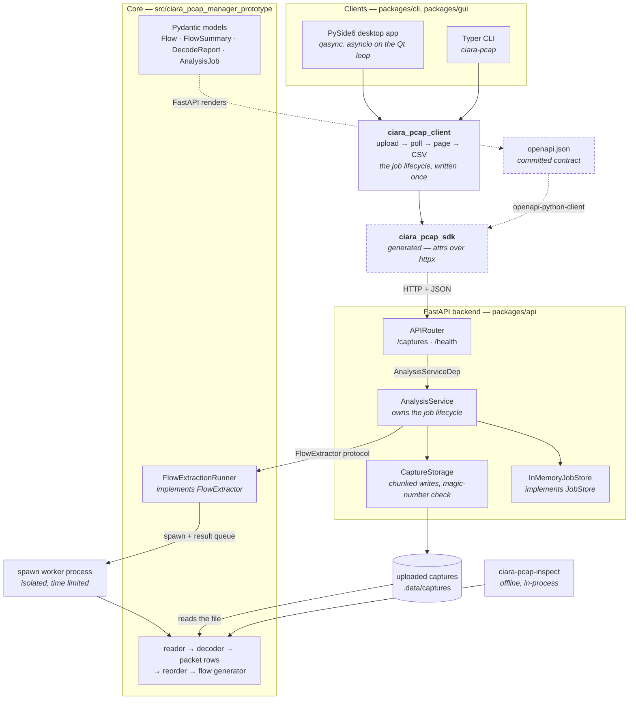

# Architecture

## System diagram



Solid edges are runtime data flow. Dashed edges are the build-time contract
path: the Pydantic models in the core are rendered into `openapi.json`, which
generates the SDK, so a client cannot drift from the backend.
[How it works](how-it-works.md) explains the packet pipeline inside the core.

## Repository layout

| Path                                  | What it is                                                                                                |
| ------------------------------------- | --------------------------------------------------------------------------------------------------------- |
| `src/ciara_pcap_manager_prototype/`   | Core library. Imports no web framework, HTTP client or GUI toolkit, and no native capture library.        |
| `src/…/config.py`                     | `CoreSettings`: storage, limits, telemetry port, timeouts and reorder window, read from `CIARA_PCAP_*`.   |
| `src/…/domain/flows.py`               | `Flow` (the 99 codebook columns, in export order), `FlowSummary`, `DecodeReport`, `FlowPage`.             |
| `src/…/domain/jobs.py`                | `AnalysisJob`, `JobStatus`.                                                                               |
| `src/…/pcap/reader.py`                | Streaming classic pcap and pcapng reader yielding `Frame`s.                                               |
| `src/…/telemetry/layers.py`           | Immutable records for the outer headers, the report header, the inner packet and the INT data.            |
| `src/…/telemetry/decoder.py`          | `decode_frame`: the Python counterpart of the Lua dissector; returns a `DecodedPacket` or a `SkipReason`. |
| `src/…/telemetry/describe.py`         | Layer-by-layer text rendering used by `ciara-pcap-inspect --inspect`.                                     |
| `src/…/flows/packet.py`               | `PacketRecord`: codebook §1 packet columns.                                                               |
| `src/…/flows/reorder.py`              | `ReorderBuffer`: restores capture-time order within a window.                                             |
| `src/…/flows/generator.py`            | `FlowGenerator`: flow keys, segments, termination reasons.                                                |
| `src/…/flows/segment.py`              | `FlowSegment`: running counters and the codebook §3 formulas.                                             |
| `src/…/flows/export.py`               | CSV in codebook column order.                                                                             |
| `src/…/pcap/extractor.py`             | `extract_flows`: wires the stages together and builds the decode report.                                  |
| `src/…/pcap/runner.py`                | `FlowExtractor` protocol and `FlowExtractionRunner`, which parses in a time-limited `spawn` process.      |
| `src/…/main.py`                       | `ciara-pcap-inspect`, the offline command line.                                                           |
| `src/…/jobs/`                         | `JobStore` protocol and the in-memory implementation.                                                     |
| `packages/api/`                       | The FastAPI application (`ciara-pcap-api`).                                                               |
| `packages/api/…/services/analysis.py` | `AnalysisService`: accept upload → schedule parse → record outcome.                                       |
| `packages/api/…/openapi.py`           | Dumps the schema from the app object, so SDK generation needs no server.                                  |
| `packages/sdk/`                       | **Generated.** Typed HTTP client. Excluded from ruff, pyright and codespell. Never hand-edit.             |
| `packages/client/`                    | Async workflow over the SDK, shared formatting, and the CSV writer for SDK flows.                         |
| `packages/cli/`                       | Typer CLI. `app.py` is commands and I/O; `rendering.py` builds Rich tables.                               |
| `packages/gui/`                       | PySide6 desktop app; see [below](#desktop-app).                                                           |
| `tools/wireshark/`                    | The team's Lua dissector, kept as delivered.                                                              |
| `docs/reference/feature_codebook.md`  | The PIPELINE_V2 feature codebook; the tests check the code against it.                                    |
| `tests/unit/`                         | Fast tests; no network. GUI widget tests skip when the Qt libraries are missing.                          |
| `tests/integration/`                  | The real 50,000-frame sample and the worker process.                                                      |
| `tests/support/`                      | `pcap_factory.py` builds INT telemetry frames from readable source; `factories.py` builds models.         |
| `scripts/check_lua_parity.py`         | Compares the decoder with the Lua dissector's tshark output.                                              |
| `openapi.json`                        | The published contract. Regenerate, never edit.                                                           |

## One lockfile, one environment

The backend's Pydantic models are the source of truth for every client, so a
schema change, the SDK regeneration and the client updates land in one commit
and are tested together. The `uv` workspace gives that without vendoring:

- `[tool.uv.workspace] members = ["packages/*"]` in the root `pyproject.toml`.
- One `uv.lock` and one `.venv`, both at the root.
- Cross-package dependencies resolve locally through `[tool.uv.sources]`.
- The root `dev` group depends on all five packages, so plain `uv sync`
  installs the whole workspace editable.

```text
ciara-pcap-prototype  (root, src/)   ← the core library
├── ciara-pcap-api    → prototype
├── ciara-pcap-sdk    (generated)
├── ciara-pcap-client → sdk
├── ciara-pcap-cli    → client, sdk
└── ciara-pcap-gui    → client, sdk
```

## Why the core decodes the packets itself

See [ADR 0001](adr/0001-decode-inner-packets-in-python.md). A generic flow
meter keys flows on the outer, switch-to-collector headers and never reaches
the user traffic inside the telemetry reports. The decoder follows the Lua
dissector's rules instead: walk the full captured frame, trust no length
field as a bound, find INT after a fixed 20-byte TCP header.

## Why uploads return 202, not the flows

Parsing a capture is CPU-bound and its duration grows with the file. The
backend writes the upload to disk in bounded chunks, creates a job, returns
`202 Accepted` with its id, and parses outside the request. Clients poll
`GET /captures/{job_id}`, then page `GET /captures/{job_id}/flows`.

This is also the contract a task-queue deployment would expose: replacing
`FlowExtractionRunner` with a Celery task and `InMemoryJobStore` with Redis
changes no route, no SDK call and no client.

## Why extraction runs in its own process

- Decoding is pure Python, so a thread would hold the interpreter lock for
  most of the parse and slow every other request.
- A hostile or corrupt capture must not take the server down.
- A parse that runs away must be stoppable.

`FlowExtractionRunner` starts one `spawn` process per capture and waits on a
result queue with a deadline, killing the worker if it overruns. Every wait
is capped by the time left, so even a deadline shorter than the polling
interval is enforced. `ProcessPoolExecutor` was rejected because it cannot time
out or terminate an individual task.

## Desktop app

```text
packages/gui/src/ciara_pcap_gui/
├── __main__.py      QApplication + qasync event loop
├── main_window.py   shell (sidebar, header, status bar) and controller
├── state.py         AnalysisState: the loaded job and flows, analysis_changed signal
├── theme.py         colour tokens (light, dark) → generated stylesheet; WCAG contrast helper
├── tones.py         semantic colours of protocols, termination reasons and job statuses
├── models.py        table models (columns declared as data) and the flow filter
├── features.py      grouping and formatting of the 99 features for the detail panel
├── pages/           base.Page and the Overview, Flows and History pages; PAGES registry
└── widgets/         cards, breakdown bars, pills, drop zone, flow detail panel
```

Pages are views over `AnalysisState`; the window performs every side effect
([ADR 0005](adr/0005-gui-pages-are-views.md)). Adding a page is one class and
one line in `PAGES`; see the [developer guide](developer-guide.md#add-a-page-to-the-desktop-app).

## SDK generation

`scripts/non-interactive/generate-sdk.sh` (`make sdk`) dumps the schema from
the application object, so generation is hermetic: no port to bind, no startup
race. The generator version is pinned in the script. It writes the published
`openapi.json` plus a temporary copy carrying one shim.

**The shim.** OpenAPI 3.1 describes an uploaded file as
`{"type": "string", "contentMediaType": "application/octet-stream"}`, which is
what FastAPI and Pydantic v2 emit. `openapi-python-client` 0.29 only
recognises the 3.0 spelling, `{"type": "string", "format": "binary"}`. Given the
3.1 form it generates a `str` field whose multipart encoder uploads the *file
name* instead of the file's bytes. `ciara_pcap_api.openapi` rewrites that one
construct for the generator's copy only, so the published contract stays
standards-correct.

A test (`tests/unit/test_domain.py`) fails when the committed `openapi.json`
no longer matches the application.
