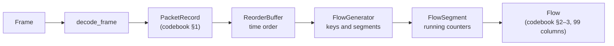

# Flow generation

How decoded inner packets become flows, and how each feature of the
PIPELINE_V2 feature codebook ([`reference/feature_codebook.md`](reference/feature_codebook.md))
is computed. Code: `src/ciara_pcap_manager_prototype/flows/`.

## 1. Packet rows (codebook §1)

`flows/packet.py` flattens each decoded inner TCP or UDP packet into a
`PacketRecord` with the codebook's parser columns. Frames that yield no inner
TCP/UDP packet never reach this stage; they are counted in the decode report
by reason (`outer_not_udp`, `not_telemetry_port`, `inner_not_tcp_udp`, ...).

| Column(s)                                                              | Source                                                                                     |
| ---------------------------------------------------------------------- | ------------------------------------------------------------------------------------------ |
| `packet_uid`                                                           | `timeframe_id \| source_file \| packet_index`                                              |
| `source_file`, `packet_index`                                          | the capture's file name (the original upload name in the API) and the frame's position     |
| `packet_time`                                                          | pcap timestamp in seconds; the exact nanoseconds are kept alongside for arithmetic         |
| `timeframe_id`                                                         | the file name without its extension                                                        |
| `direction`                                                            | always `unknown`: a single packet does not say which way its flow runs                     |
| `inner_ip_src`, `inner_ip_dst`, `inner_ip_proto`                       | inner IPv4 header                                                                          |
| `l4_proto`, `src_port`, `dst_port`                                     | inner TCP or UDP header                                                                    |
| `tcp_dataofs`, `tcp_header_len_bytes`, `tcp_options_len`               | TCP data offset, ×4, and `max(×4 − 20, 0)`; all 0 for UDP                                  |
| `inner_ip_len`, `inner_ip_total_length_declared`                       | inner IPv4 Total Length (the same value; the codebook lists both)                          |
| `int_ingress_timestamp`, `int_egress_timestamp`, `int_queue_occupancy` | hop 1 of the INT stack (the most recent switch); blank without INT                         |
| `inner_ip_truncated_vs_declared`                                       | bytes from the inner IPv4 header to the end of the frame ≠ Total Length                    |
| `inner_udp_truncated_vs_declared`                                      | UDP only: bytes from the UDP header to the end of the frame ≠ UDP Length; false for TCP    |
| `tcp_flag_*`                                                           | TCP flags byte (FIN 0x01, SYN 0x02, RST 0x04, PSH 0x08, ACK 0x10, URG 0x20); false for UDP |
| `capture_start_*`, `capture_end_*`                                     | blank: only defined for files named after a time range, and no such naming is in use       |

The generator also uses three INT aggregates per packet that the codebook's
packet table does not list: the number of hops, the **path latency** (sum of
the hops' latencies) and every hop's queue occupancy.

## 2. Time order

The bundled capture interleaves three report streams that lag one another by
up to 115 ms, so 22,220 of its 50,000 frames are read after a frame with a
later timestamp. Flow features depend on order (first packet, duration, INT
inter-arrival), so `flows/reorder.py` holds packets for a window of capture
time (default **1 s**, `CIARA_PCAP_REORDER_WINDOW_SECONDS`) and releases them
oldest first. Memory is bounded by the packets that arrive within one window.
A packet lagging by more than the window cannot be put back; it is processed
as it comes and counted as `packets_late` (0 in the sample). A window of 0
keeps file order.

## 3. Flow keys and segments (codebook §2)

**Key.** `base_flow_key = proto|ip_low|ip_high|port_low|port_high`. The two
endpoints are ordered by (address, port), comparing addresses numerically,
and each port stays with its own address. Both directions of a conversation
therefore share one key, and TCP and UDP between the same ports are different
flows.

**Segments.** A key's packets are split into segments, numbered from 0
(`flow_segment_id`; `flow_id = base_flow_key|segment`). A segment closes for
one of the codebook's reasons:

| `termination_reason` | When                                                                                                                                                                                     |
| -------------------- | ---------------------------------------------------------------------------------------------------------------------------------------------------------------------------------------- |
| `inactive_timeout`   | more than 120 s (`CIARA_PCAP_FLOW_IDLE_TIMEOUT_SECONDS`) without a packet; checked when the next packet arrives and, for every open segment, each time capture time advances by a second |
| `active_timeout`     | the next packet would arrive more than 1,800 s (`CIARA_PCAP_FLOW_ACTIVE_TIMEOUT_SECONDS`) after the segment's first packet                                                               |
| `tcp_rst`            | a TCP packet with RST; the RST packet is the segment's last                                                                                                                              |
| `tcp_fin_both`       | FIN has been seen in both directions; the packet completing the pair is the last, so a trailing ACK opens a new segment                                                                  |
| `end_of_input`       | still open when the capture ends                                                                                                                                                         |

A packet that arrives after its segment closed opens the next segment of the
same key. In the 1-second sample nearly every flow ends as `end_of_input`
(15,174), with 283 `tcp_rst` and 1 `tcp_fin_both`.

**Orientation.** A and B come from the segment's first packet (after
reordering): `ip_a`/`port_a` is its source, `ip_b`/`port_b` its destination.
Forward (`fwd`) means A → B. As the codebook notes, `first_observed_*`,
`first_packet_direction = fwd` and `flow_initiator = observed_first_packet_src` are deliberately redundant with that.
`initiator_confidence` is `tcp_syn_noack_observed` when the first packet is a
bare TCP SYN and `observed_first_packet` otherwise.

**Provenance.** `source_file_count` is 1 plus the number of times the source
file changed within the segment, and `crosses_file_boundary` is 1 when it
exceeds 1. The API analyses one file per job, so these are always 1 and 0
there; the logic exists for multi-file input.

## 4. Per-flow features (codebook §3)

Sizes are inner IPv4 Total Length values. All standard deviations are
**population** standard deviations, computed with Welford's online algorithm:
mathematically the codebook's `sqrt(sum_sq/n − mean²)` clamped at zero, but
without the rounding error that formula suffers on nanosecond-scale numbers.

| Group                    | Features and rules                                                                                                                                                                                                                         |
| ------------------------ | ------------------------------------------------------------------------------------------------------------------------------------------------------------------------------------------------------------------------------------------ |
| Counts (§3.1)            | `pkts_*`, `bytes_*` per direction and in total; `duration = last − first` in seconds                                                                                                                                                       |
| Rates (§3.2)             | `*_pps`, `*_Bps` = amount ÷ duration; **0.0 when duration is 0** (no 1-second clamp)                                                                                                                                                       |
| Sizes (§3.3)             | `mean_pkt_size`, `pkt_size_std`, `pkt_size_min`, `pkt_size_max`                                                                                                                                                                            |
| Hops (§3.4)              | `mean_hop_count` over packets that carried at least one INT hop                                                                                                                                                                            |
| Latency (§3.4)           | per packet, the path latency (sum over hops); `mean_hop_latency`, `latency_min`, `latency_max`, `latency_std` over packets that have one; blank otherwise                                                                                  |
| INT inter-arrival (§3.4) | for consecutive packets of the segment that both carry an INT timestamp (hop 1 egress, else ingress): `(t − t_prev) mod 2³²`. `iat_int_count` observations; with 0, every IAT statistic is `0.0`; with 1, mean = min = max and std = `0.0` |
| Queue (§3.4)             | `queue_occupancy_mean/std/max` over every hop's queue occupancy; blank without observations                                                                                                                                                |
| TCP flags (§3.5)         | for each of SYN, ACK, FIN, RST, PSH, URG: counts per direction, ratio = count ÷ packets in that direction, fraction = both counts ÷ `pkts_total`; **0.0 when the denominator is 0**                                                        |
| Directionality (§3.6)    | `bytes_per_pkt_fwd/bwd` (0.0 when no packets), `bytes_per_pkt_gap`; `fwd_share_pkts/bytes` (**blank** when the denominator is 0)                                                                                                           |
| Quality (§3.7)           | `small_pkt_fraction_total` (≤ 100 bytes), `tiny_pkt_fraction_total` (≤ 40 bytes), `syn_ack_gap = syn_count_fwd − ack_count_bwd`, `truncated_ip_fraction`, `truncated_udp_fraction`                                                         |

Blank values are `null` in JSON and empty cells in CSV, as in the codebook.
Integer flags such as `first_packet_syn` are 0 or 1.

## 5. Where the codebook had to be interpreted

The codebook describes an existing pipeline in prose. Where it leaves a
choice open, the prototype makes the choice below. Each is a small, isolated
piece of code if the team's pipeline turns out to differ.

| Topic                          | Codebook says                                  | Prototype does                                                                                                  |
| ------------------------------ | ---------------------------------------------- | --------------------------------------------------------------------------------------------------------------- |
| Timeout values                 | segments close on inactive and active timeouts | 120 s idle, 1,800 s active, both configurable                                                                   |
| `port_low` / `port_high`       | `proto\|ip_low\|ip_high\|port_low\|port_high`  | each port stays paired with its address; ties on address order by port                                          |
| `flow_segment_id` start        | "incrementing segment counter"                 | starts at 0                                                                                                     |
| `tcp_fin_both` closing packet  | close reason only                              | the packet that completes the FIN pair closes the segment                                                       |
| Which INT hop is "the" hop     | packet columns are single values               | hop 1 (top of the stack, the most recent switch); the sample has one hop per packet                             |
| `mean_hop_latency` denominator | `latency_sum / hop_count_count`                | divides by packets that have a latency value; identical whenever every hop reports timestamps, as in the sample |
| INT inter-arrival order        | "egress-first fallback logic, wrap-aware"      | consecutive packets in capture-time order, after the reorder buffer                                             |
| `timeframe_id`                 | "from filename/range naming"                   | the file name without its extension                                                                             |
| `direction` (packet row)       | `fwd`, `bwd`, `all`, `unknown`                 | `unknown` at parse time; the generator orients packets per segment                                              |
| `source_file_count`            | "count of distinct source-file transitions"    | 1 + number of source-file changes                                                                               |

## 6. Known effects in the data

- **INT inter-arrival across switches.** INT timestamps are per-switch
  counters. When two consecutive packets of a flow were reported by different
  switches, their difference mixes two clocks, and a negative difference wraps
  to nearly 2³² ns. With reordering, this happens for 8 of the sample's 34,542
  inter-arrival observations (5 flows); in all 8 the two packets came from
  different switches (switch 24 followed by 23 or 262146). Without reordering
  it happens 146 times. The codebook's definition is kept; a per-switch
  inter-arrival would avoid it if the team wants that.
- **Counter wrap.** Gaps longer than 2³² ns ≈ 4.295 s cannot be represented by
  an INT inter-arrival.
- **Short capture.** The sample spans 1.004 s, far below the idle and active
  timeouts, so almost every segment ends with the capture.

## What is not implemented

- **Codebook §4, the enricher** (contextual `fwd_dst_*`, `bwd_dst_*`,
  `fwd_src_*`, `bwd_src_*` columns). Its aggregate keys start with
  `timeframe_id`, which only has meaning with the team's timeframe file
  naming, and the codebook does not say whether forward and backward
  contributions share one aggregate table. It belongs after the generator, as
  a pass over finished flows.
- **Codebook §5, labels.** `label`, `class_label` and the episode columns need
  the attack-episode schedule, which is not part of a capture file.
- **Several capture files in one analysis.** The generator tracks source
  files per segment, but the API and the CLI submit one file per job.
