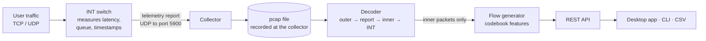
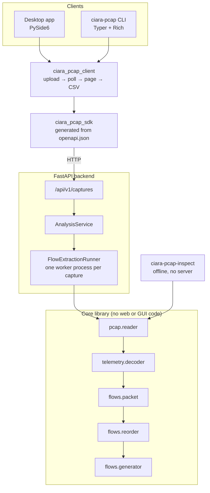

# How it works

This is the end-to-end explanation of the prototype: what is in the capture
files, which packets we read and which we throw away, how flows are built, and
how the results reach the user. Each section links to a deeper document.

## The one-minute version

1. Programmable switches in the network watch user traffic. For selected
   packets they record **In-band Network Telemetry (INT)**: which switch and
   ports the packet used, when it entered and left, and how full the queue was.
1. The switch does not keep that information. It copies the packet's headers
   plus the INT measurements into a **telemetry report** and sends the report to
   a **collector** as a UDP datagram to port 5900.
1. Our capture files are recordings of the collector's network link. Every
   captured frame is therefore **two packets nested inside each other**:
   - the **outer packet** (the "cover" or envelope): switch → collector, UDP
     port 5900. It is the same handful of addresses in every frame and says
     nothing about user traffic;
   - the **inner packet**: the user's TCP or UDP packet that the switch
     observed, followed by the switch's INT measurements of it.
1. The prototype decodes every frame layer by layer, **discards the outer
   packet**, and groups the **inner packets** into bidirectional **flows**
   (conversations between two endpoints). For every flow it computes the 99
   features defined in the PIPELINE_V2 feature codebook, including INT-based
   ones such as hop latency and queue occupancy.
1. The flows are available through a REST API, a command line tool, a desktop
   application and CSV export in the codebook's column order.



## Why the old version showed only three flows

The previous prototype parsed captures with NFStream, a general-purpose flow
meter. A flow meter groups packets by their **outermost** IP and port fields.
In these captures those are always the switch-to-collector envelope, so the
whole 50,000-packet sample collapsed into three "flows", one per reporting
switch:

| Outer source           | Outer destination     | Frames |
| ---------------------- | --------------------- | -----: |
| `10.236.153.180:6000`  | `10.236.153.185:5900` | 29,218 |
| `94.8.56.51:6002`      | `10.236.153.185:5900` | 17,848 |
| `204.207.103.137:6001` | `10.236.153.185:5900` |  2,934 |

The real traffic is one layer down. Reading it needs a decoder that knows the
telemetry report and INT formats, which is what the Wireshark Lua dissector
the team uses does. The prototype now does the same thing in Python. On the
sample it decodes all 50,000 inner packets into **15,458 flows**: 10,383 TCP
and 5,075 UDP.

## The layers of one frame

```text
┌─ OUTER (envelope, discarded after checking) ──────────────────────────────┐
│ Ethernet │ 802.1Q VLAN │ IPv4 (switch → collector) │ UDP (→ port 5900)    │
├─ TELEMETRY REPORT HEADER (16 bytes) ──────────────────────────────────────┤
│ version · length · flags · switch id · sequence number · ingress time     │
├─ INNER (the user packet, kept) ───────────────────────────────────────────┤
│ Ethernet │ 802.1Q VLAN │ IPv4 (user A → user B) │ TCP (20 B) or UDP (8 B) │
├─ INT (the switch's measurements of the inner packet) ─────────────────────┤
│ shim (4 B) │ metadata header (8 B) │ one record per switch ("hop")        │
└───────────────────────────────────────────────────────────────────────────┘
```

[Packet anatomy](packet-anatomy.md) walks through a real frame byte by byte.
[INT telemetry](int-telemetry.md) explains every INT and report field.

## Three rules the decoder follows

These come straight from the Lua dissector and are why a generic tool cannot
read these captures:

1. **Walk the headers structurally; never trust a length field to say where
   the data ends.** The collector truncates the inner packet and appends the
   INT stack, so the inner IPv4 Total Length describes the *original* packet
   (often 1,500 bytes) while only a few hundred bytes were captured. In the
   sample, 45,514 of 50,000 inner packets have a declared length different from
   the bytes present, and the outer IPv4 length disagrees with the frame size
   in every frame. The only trustworthy boundary is the number of bytes
   actually captured.
1. **INT starts right after a fixed 20-byte TCP header (or 8-byte UDP header).**
   The TCP data-offset field still says 32 or more bytes for many packets
   (18,547 inner TCP packets declare 32), but in this collector layout the INT
   shim always sits immediately after the first 20 TCP bytes. Following the data
   offset would read options that are not there and miss the INT data.
1. **Bound INT by INT's own fields.** The shim's length (in 4-byte words)
   covers the shim, the metadata header and the stack; Hop ML says how many
   words each switch's record takes. Both are capped at the bytes captured.

## From packets to flows

Each decoded inner packet becomes a **packet row** (codebook section 1). Rows
are grouped by a direction-independent key, so `A:p → B:q` and `B:q → A:p`
land in the same flow:

```text
proto | lower address | higher address | port of lower | port of higher
6     | 187.84.112.102 | 203.49.118.225 | 14598        | 443
```

A flow is cut into **segments** when it goes quiet (inactive timeout, 120 s by
default), lasts too long (active timeout, 1,800 s), sees a TCP RST, sees FIN
from both sides, or the capture ends. Each segment gets the codebook's
identity, count, rate, size, INT, TCP-flag and quality features.

One thing had to be added that the codebook does not mention: **putting
packets back in time order**. The sample interleaves three report streams, one
per switch. Each stream is in order, but they lag one another by up to 115 ms,
so 22,220 frames arrive with a timestamp earlier than one already read. Fed in
file order, a flow's first packet might not be its earliest, and a slightly
negative INT time difference turns into roughly 4.29 seconds once it wraps
around the 32-bit counter. A one-second reorder buffer restores time order
before flows are built; it cut those wrapped values in the sample from 146 to 8.

[Flow generation](flow-generation.md) documents every rule, every feature
formula, and every point where the codebook had to be interpreted.

## How the software is put together



- The **core library** (`src/ciara_pcap_manager_prototype`) holds the decoder
  and the flow generator. It has no web or GUI dependencies and no native
  packet-capture library; it reads pcap and pcapng files itself.
- The **backend** (`packages/api`) accepts an upload, returns `202 Accepted`
  with a job id at once, and parses the capture in a separate, time-limited
  worker process so the server stays responsive.
- The **SDK** (`packages/sdk`) is generated from the backend's OpenAPI
  contract, so the clients cannot drift from the server.
- The **desktop app** (`packages/gui`) and the **CLI** (`packages/cli`) share
  one workflow and one CSV writer (`packages/client`).
- `ciara-pcap-inspect` runs the core pipeline offline: it prints any frame
  layer by layer, or exports flows to CSV without a server.

[Architecture](architecture.md) has the file-by-file breakdown, and
[User guide](user-guide.md) shows the interfaces.

## How we know it is right

| Check                               | What it compares                                                                                                                                             | Result on the 50,000-packet sample    |
| ----------------------------------- | ------------------------------------------------------------------------------------------------------------------------------------------------------------ | ------------------------------------- |
| Lua parity                          | 22 fields per frame (report header, INT shim and hop, outer and inner IPv4, inner TCP/UDP, VLAN ids) against the Wireshark Lua dissector run in tshark 4.2.5 | 1,100,000 fields, 0 differences       |
| Codebook column order               | the CSV header against section 6 of the codebook file in `docs/reference`                                                                                    | identical, 99 columns                 |
| Same result through every interface | CSV from the offline tool, the CLI (via API and SDK) and the desktop app                                                                                     | byte-identical                        |
| Specification review                | header layouts against P4.org INT v1.0 and Telemetry Report v1.0                                                                                             | see [INT telemetry](int-telemetry.md) |
| Automated tests                     | 238 tests: decoder, reader, every feature formula, segmentation, API, CLI, GUI                                                                               | all pass                              |

Run the Lua comparison yourself with
`bash scripts/non-interactive/check-lua-parity.sh` (it uses a local tshark, or
tshark in a container).

## Limits worth knowing

- **INT time differences across switches.** INT timestamps are each switch's
  own 32-bit nanosecond counter. When consecutive packets of one flow are
  reported by different switches, their difference compares two unrelated
  clocks. In the sample this is the cause of all 8 remaining wrapped
  inter-arrival values (out of 34,542). The codebook defines the inter-arrival
  this way, so the prototype follows it and documents the effect.
- **The 32-bit counter wraps every 4.295 seconds.** An INT inter-arrival time
  cannot represent a gap longer than that.
- **Only the first INT instruction byte is decoded**, exactly like the Lua.
  Every frame in the sample uses instruction bits 0 to 5 (`0xFC`).
- **Section 4 (enricher) and section 5 (labels) of the codebook are not
  implemented.** The enricher's aggregate keys depend on a timeframe naming
  scheme and on details the codebook leaves open, and labels need episode
  metadata that the capture does not contain. See
  [Flow generation](flow-generation.md#what-is-not-implemented).
- **Jobs live in memory.** Restarting the backend forgets earlier analyses.
