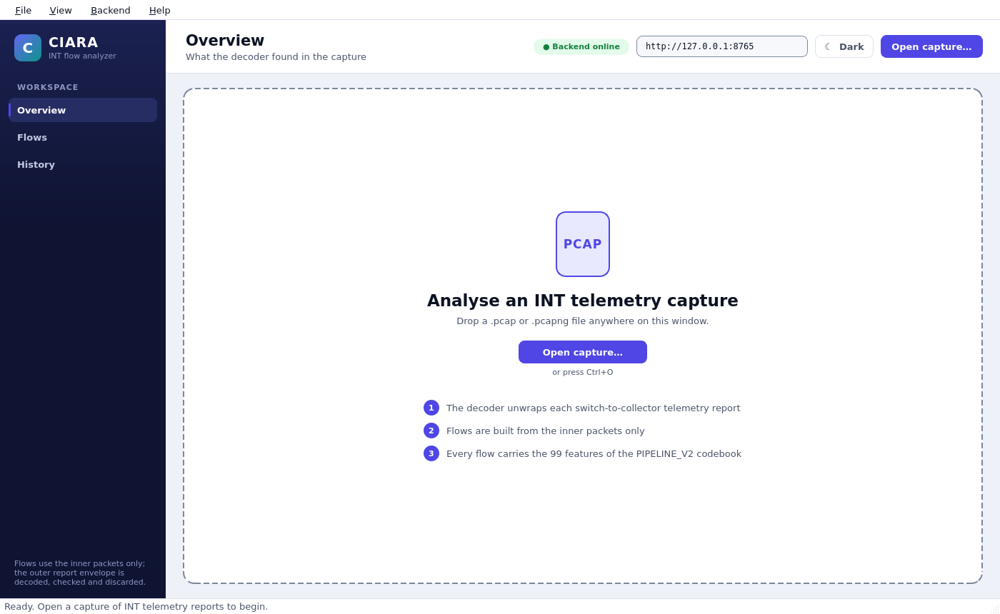
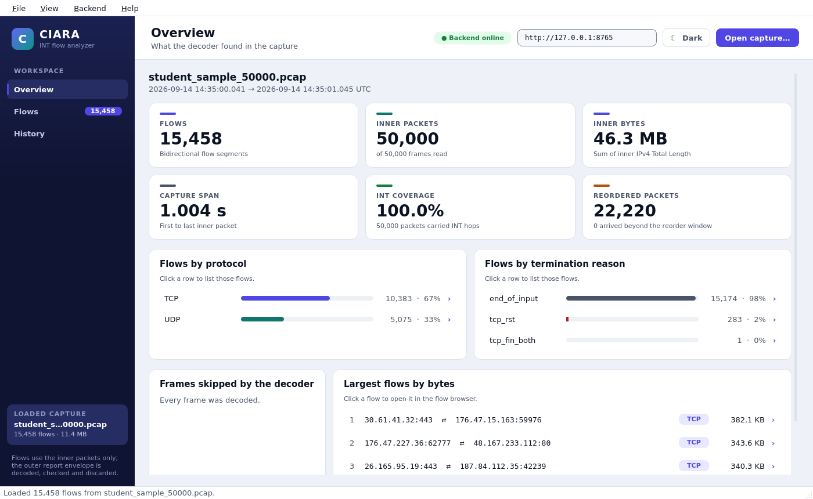
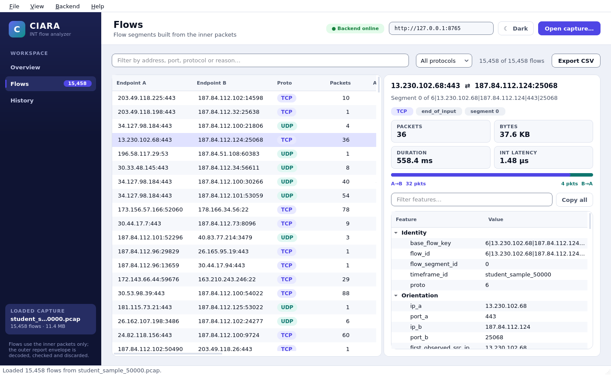
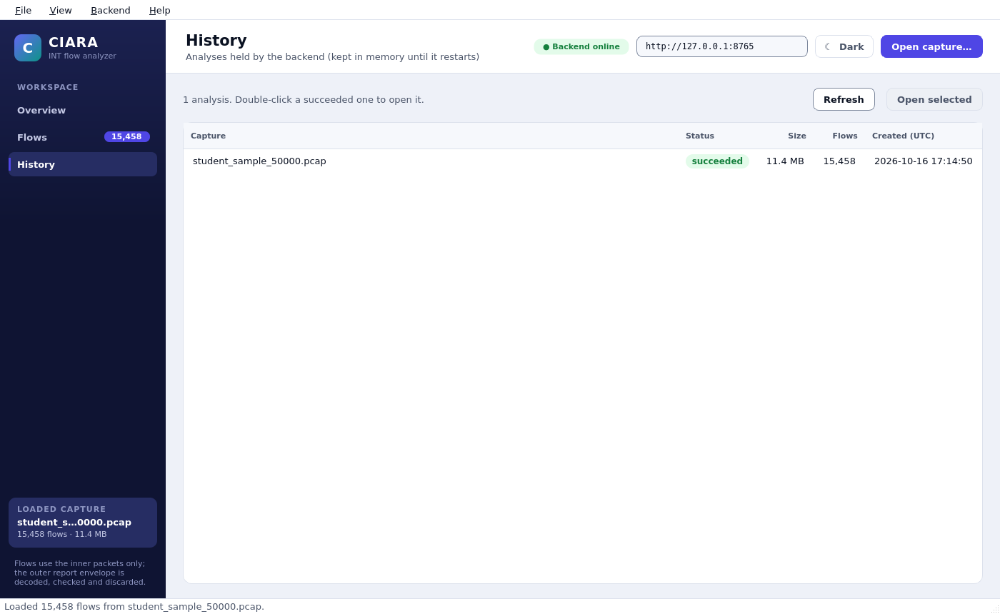
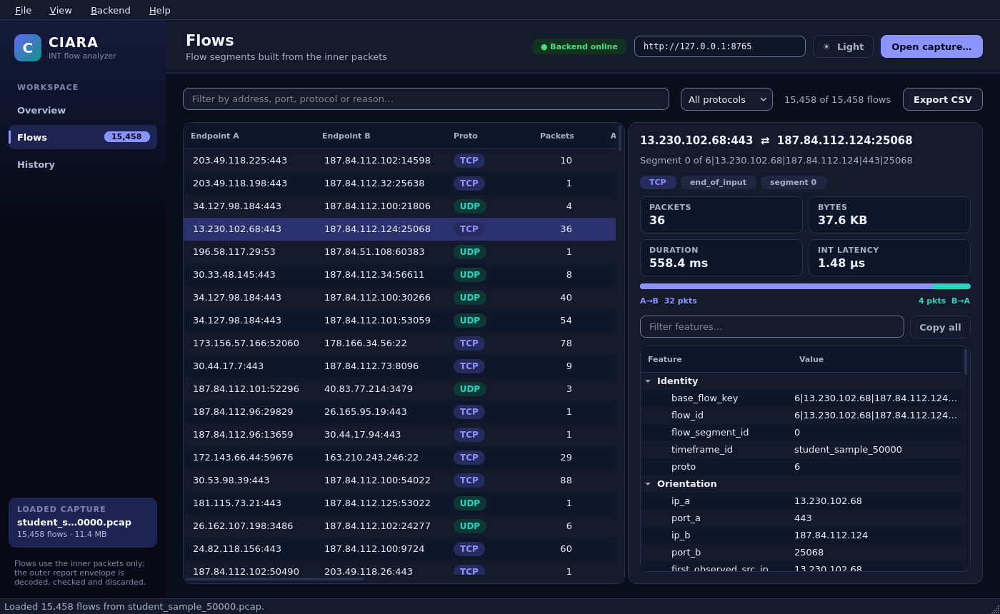

# User guide

Three ways to analyse a capture: the desktop app, the `ciara-pcap` command
line, and the offline `ciara-pcap-inspect` tool. The first two talk to the
backend; the third needs nothing running.

```bash
uv sync                      # once per clone
uv run ciara-pcap-api        # start the backend (http://127.0.0.1:8000)
uv run ciara-pcap-gui        # in a second terminal
```

On Windows, `launch.bat` starts the backend and the desktop app together and
stops both when the window closes.

## Desktop app

### Start



The header shows the backend's status (*Backend online* / *offline*; click
it to check again), its URL (editable; remembered between sessions), the
theme switch and **Open capture…**. Open a `.pcap` or `.pcapng` file with the
button, *File → Open capture…* (Ctrl+O), or by dragging it onto the window.
The upload, the parse and the download of the flows run in the background;
the window stays usable and the status bar reports progress.

Once a capture is loaded, the sidebar names it and shows its flow count next
to **Flows**.

### Overview



Headline numbers for the capture:

| Card              | Meaning                                                                                                                |
| ----------------- | ---------------------------------------------------------------------------------------------------------------------- |
| Flows             | flow segments built from the inner packets                                                                             |
| Inner packets     | frames whose inner TCP/UDP packet was decoded, out of the frames read                                                  |
| Inner bytes       | sum of the inner packets' IPv4 Total Length                                                                            |
| Capture span      | first to last inner packet                                                                                             |
| INT coverage      | share of inner packets that carried at least one INT hop                                                               |
| Reordered packets | packets read out of time order and put back by the reorder buffer; the caption shows any that lagged beyond the window |

Below them: flows by protocol, flows by termination reason, frames the decoder
skipped and why, and the five largest flows by bytes. These are shortcuts
into the flow browser:

- click a protocol (**TCP**, **UDP**) to list only its flows;
- click a termination reason (**tcp_rst**…) to filter the flows by it;
- click one of the largest flows to open it with its features shown.

Colours carry meaning everywhere: TCP is indigo and UDP teal; a clean
`tcp_fin_both` close is green, a `tcp_rst` reset red, an `active_timeout`
amber.

### Flows



Every flow segment, one per row; protocol and termination reason are shown
as coloured tags. Click a column header to sort; numbers sort
numerically. The filter box matches addresses, ports, protocol, termination
reason and flow id; every word typed must match (`187.84.112.97 udp`). The
protocol menu narrows to TCP or UDP. Ctrl+F jumps to the filter.

Selecting a row opens its summary on the right: packets, bytes, duration and
mean INT latency, and a bar splitting the packets into A→B (indigo) and B→A
(teal). Below it are **all 99 codebook features** of the flow, grouped as in
the codebook (identity, orientation, counts, provenance, rates, sizes, INT,
TCP flags, directionality and quality). Type in *Filter features…* to narrow
them by name (`latency`, `pkts`). Hover a value for its exact, unrounded
form; select rows and press Ctrl+C, or press **Copy all**, to copy them as
`feature<TAB>value` lines.

**Export CSV** (or Ctrl+E) writes every flow, not just the filtered ones, with
the codebook's 99 columns in its export order. The file is identical to the
ones the CLI and `ciara-pcap-inspect` write.

### History



Lists the analyses the backend holds (Ctrl+R to refresh), with each status as
a coloured tag. Double-click a succeeded one, or select it and press **Open
selected**, to load it again without re-uploading. The backend keeps analyses in memory, so the list
empties when it restarts.

### Themes and shortcuts

The header's **Dark** / **Light** button, *View → Toggle dark theme* or
Ctrl+T switches between the light and dark themes; the choice, the backend
URL and the window size are remembered. On first start the app follows the
operating system's colour scheme. Both themes meet WCAG 2.2 contrast: body
text at 7:1 or more, all other text at 4.5:1, input borders at 3:1.



| Shortcut   | Action                   |
| ---------- | ------------------------ |
| Ctrl+O     | Open a capture           |
| Ctrl+E     | Export flows as CSV      |
| Ctrl+1/2/3 | Overview, Flows, History |
| Ctrl+F     | Filter flows             |
| Ctrl+R     | Refresh history          |
| Ctrl+T     | Toggle dark theme        |
| Ctrl+Q     | Quit                     |

## Command line: `ciara-pcap`

```bash
uv run ciara-pcap health                                   # is the backend reachable?
uv run ciara-pcap analyze samples/student_sample_50000.pcap
uv run ciara-pcap analyze capture.pcap --limit 0           # print every flow
uv run ciara-pcap analyze capture.pcap --csv flows.csv     # also save the codebook CSV
uv run ciara-pcap analyze capture.pcap --json | jq .       # machine-readable
uv run ciara-pcap jobs                                     # list analyses
uv run ciara-pcap flows <job-id> --csv flows.csv           # re-read a finished analysis
```

`analyze` prints a summary (frames read, inner packets, INT coverage, flows,
bytes, time range, protocols, termination reasons, reordering, skipped
frames) and a flow table. Point it at another backend with `--api-url` or
`CIARA_PCAP_API_URL`.

## Offline: `ciara-pcap-inspect`

Runs the decoder and the flow generator in-process, without a backend. Useful
for looking inside a capture and for scripting.

```bash
uv run ciara-pcap-inspect samples/student_sample_50000.pcap               # summary
uv run ciara-pcap-inspect samples/student_sample_50000.pcap --inspect 3   # first 3 frames, layer by layer
uv run ciara-pcap-inspect capture.pcap --csv flows.csv                    # codebook CSV
uv run ciara-pcap-inspect capture.pcap --port 9555                        # reports on another UDP port
```

```text
$ uv run ciara-pcap-inspect samples/student_sample_50000.pcap
student_sample_50000.pcap
  frames read            50000
  inner packets decoded  50000
  packets with INT       50000
  out of order           22220
  late beyond window     0
  flows                  15458
```

[Packet anatomy](packet-anatomy.md) shows and explains the `--inspect` output.

## Settings

The backend reads these from the environment or a `.env` file:

| Variable                                 | Default          | Meaning                                                            |
| ---------------------------------------- | ---------------- | ------------------------------------------------------------------ |
| `CIARA_PCAP_HOST` / `CIARA_PCAP_PORT`    | `127.0.0.1:8000` | bind address                                                       |
| `CIARA_PCAP_STORAGE_DIR`                 | `.data/captures` | where uploads are written                                          |
| `CIARA_PCAP_MAX_UPLOAD_BYTES`            | 2 GiB            | upload size limit                                                  |
| `CIARA_PCAP_EXTRACTION_WORKERS`          | `2`              | captures parsed at the same time                                   |
| `CIARA_PCAP_EXTRACTION_TIMEOUT_SECONDS`  | `300`            | stop a parse that runs longer                                      |
| `CIARA_PCAP_TELEMETRY_UDP_PORT`          | `5900`           | outer UDP destination port of telemetry reports                    |
| `CIARA_PCAP_FLOW_IDLE_TIMEOUT_SECONDS`   | `120`            | close a flow segment after this long without a packet              |
| `CIARA_PCAP_FLOW_ACTIVE_TIMEOUT_SECONDS` | `1800`           | close a flow segment that has lasted longer than this              |
| `CIARA_PCAP_REORDER_WINDOW_SECONDS`      | `1.0`            | capture time to buffer to restore time order; `0` keeps file order |
| `CIARA_PCAP_MAX_FLOWS_PER_CAPTURE`       | `0`              | cap on flows per capture; `0` means no limit                       |
